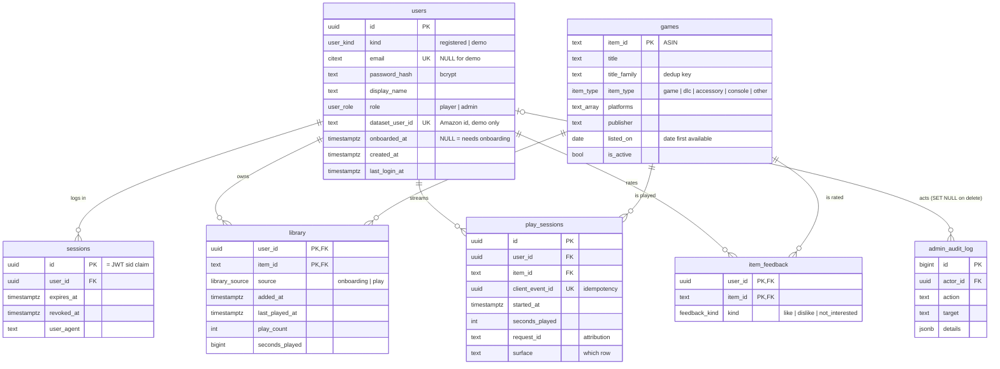

# Database schema (P1): Postgres for RecoSphere Play

> **Since P1 phase A (2026-11-17)** the schema is owned by the SQLAlchemy models in `app_api/models/` and
> changed through Alembic (`app_api/migrations/`). `001_init.sql` below is the baseline revision
> (`0001_baseline`); `tests/app_api/test_models.py` proves the models build exactly this schema. Plan:
> `docs/platform/P1_ROADMAP.md`.

Migration: `web/db/migrations/001_init.sql`. Target: Postgres 16+ (Neon in the cloud, the `postgres`
service in `infra/compose` locally; same SQL for both).

## What goes in Postgres, and what does not

Postgres is the **system of record for user-owned state**: things a user creates and expects to find
again, that need transactions and foreign keys.

| Data | Where | Why |
|---|---|---|
| accounts, sessions, library, plays, feedback, admin actions | **Postgres** | small, transactional, read back by the app |
| catalog (games) | **Postgres** (copy) + engine | FK target for plays; game/accessory flag; search; dedup families |
| exposures, impressions, clicks | JSONL now → Redpanda + lake (P3) | 20–80 rows per page view, append-only, analytics: would bloat an OLTP DB |
| model artifacts, embeddings, FAISS index | `models/` now → MinIO (P2) | large binary files, versioned by run |
| experiment assignment | nowhere | deterministic salted sha256 of the user id; recomputed, never stored |
| feature store (popularity windows, user features) | Redis | low-latency serving reads, rebuilt from data |

## Tables (7)

| # | Table | Purpose | Key design choices |
|---|---|---|---|
| 1 | `users` | everyone who uses the app | `kind` separates signups from demo players; CHECKs enforce email+hash for registered and a dataset id for demo; `citext` makes `A@x.com` = `a@x.com`; `onboarded_at` replaces a separate onboarding table |
| 2 | `sessions` | server side of the JWT cookie | a stateless JWT cannot be revoked; with `sid` → row, logout / sign out everywhere / ban work. Checked on API routes, not in edge middleware |
| 3 | `games` | the app's catalog | `item_type` (the accessory fix) and `title_family` (edition dedup) live in data, not in code; trigram index for typo-tolerant search; `is_active` hides an item without breaking old plays |
| 4 | `library` | current state per (user, game) | onboarding picks and plays in one place; this is the history sent to the engine and the "Continue playing" row; updated in the same transaction as `play_sessions` |
| 5 | `play_sessions` | append-only stream history | `client_event_id UNIQUE` makes a retried request a no-op; `request_id` + `surface` attribute each play to the recommendation that caused it (offline eval, retraining) |
| 6 | `item_feedback` | explicit signals | one current value per (user, game); serving drops `dislike` / `not_interested` |
| 7 | `admin_audit_log` | who did what in /admin | rollbacks and experiment changes are auditable; actor becomes NULL if the admin is deleted, the record stays |

`schema_migrations` (created by the migration runner) records which files have been applied.

### Why not more tables
- **No `onboarding_picks`**: a pick is a `library` row with `source = 'onboarding'`.
- **No `experiment_assignments`**: assignment is a pure function of (salt, user id).
- **No `recommendations` / `exposures`**: event volume belongs in the stream + lake (P3).
- **No `platforms` / `publishers` lookup tables**: read-only attributes of a loaded catalog; `text[]` is enough until there is an admin UI that edits them.

### Why not fewer
- `library` vs `play_sessions`: the first answers "what does this user have, most recent first" with one
  indexed read; the second keeps every event for evaluation. Deriving one from the other per request is a
  GROUP BY on the hot path.

## Rules
- **Every play is one transaction**: insert `play_sessions` + upsert `library`.
- **Deleting a user cascades** to sessions, library, plays and feedback (right to be forgotten); the
  audit log keeps the action with `actor_id = NULL`.
- **Catalog sync**: `scripts/load_catalog.py` upserts `games` from gold metadata on every model release.
  An item is shown only if it is in both the engine's catalog and `games` (is_active, game/dlc).
- **Migrations are forward-only SQL files**, applied by a runner in CI, on `make up` and before deploy.
  Never edit an applied file; add `002_...sql`.

## Neon specifics
- Two connection strings in `.env` (never committed): `DATABASE_URL` = the **pooled** host
  (`-pooler`) for the app, `DATABASE_URL_DIRECT` for migrations. `sslmode=require`.
- Neon **branches** give CI and experiments a copy-on-write database: create a branch per PR, run
  migrations + e2e on it, delete it.
- The free tier suspends when idle; the first query after that is slower, so the app's health check
  must tolerate it.
- Neon is managed, but the schema is plain Postgres: the compose `postgres` service runs the same
  migrations, so nothing is tied to Neon.

## Files and commands
| File | What |
|---|---|
| `web/db/migrations/001_init.sql` | the schema above: 5 enums, 7 tables, constraints, indexes, `citext` + `pg_trgm` |
| `web/db/migrate.mjs` | forward-only runner: one transaction per file (so files carry no BEGIN/COMMIT), `schema_migrations` with a sha256 checksum; an applied file that changed is refused; advisory lock = one runner at a time |
| `web/db/check_schema.mjs` | the scenarios of `test_schema.sql` plus a few more, inside ONE transaction that is rolled back (safe on Neon) |
| `web/db/test_schema.sql` | the same scenarios as a psql script; it WRITES rows, so only for a throwaway database |
| `er.png` | the ER diagram above as an image |

`make db-migrate` · `make db-status` · `make db-check` (read `web/.env.local`). CI job `db` runs migrate,
check and migrate-again on a Postgres 16 container (never Neon: no secret in CI).

## Verified (2026-11-15)
- **Neon** (PostgreSQL 18.7): `001_init.sql` applied; `check_schema.mjs` 18/18 passed and left 0 rows; a
  second `migrate` was a no-op ("up to date"); editing an applied file made `migrate` refuse with an error.
- **Postgres 16**: the same files in CI (job `db`).

Rejected as designed: duplicate email differing only in case, registered user without a password, demo
user without a dataset id, duplicate dataset id, play for an unknown game, retried play with the same
`client_event_id`, negative seconds, a play ending before it starts, a login session expiring before it
starts, an unknown `item_type`.
Behaved as described: `kind` defaults to `registered`; the play transaction (a retry with `ON CONFLICT DO
NOTHING` is a no-op); history most recent first; dedup by `title_family` + `not_interested` + accessory
filter; trigram search with a typo; delete cascade; audit row kept with `actor_id = NULL`.

Search, checked on the real catalog (2026-11-17, one query, `'fantsy remake'`): `similarity()` misses the long
`Final Fantasy VII Remake - PlayStation 4 Deluxe Edition` (0.23, under the 0.3 threshold) and ranks Final
Fantasy VIII above it; `word_similarity()` ranks all three FF7 Remake listings first (0.57 each). But the `<%`
operator's default threshold is 0.6, so `'fantsy remake' <% title` returns NOTHING. App search: rank by
`word_similarity`, set `pg_trgm.word_similarity_threshold` per query (0.5 already lets in "The House of the
Dead: Remake" at 0.50); tune it on more queries when the search moves here.

## Catalog in `games` (P1 phase C, 2026-11-17)
`make load-catalog` (`scripts/load_catalog.py` → `app_api/services/catalog_service.py`): 25,612 rows (12,422 game,
13,045 accessory, 145 other), one transaction, batches of 1,000, idempotent (second run: 0 inserted, 0 updated),
missing items deactivated, never deleted. Laptop → Neon us-east-1: first load 94 s, an unchanged reload 40 s (the
rows are uploaded either way). Neon storage after the load: `games` 23 MB, whole database 32 MB.
- Types: the classifier has 3, the schema 5: `game`/`accessory`/`other` map 1:1; `console` and `dlc` stay unused
  until the classifier separates them (consoles are `accessory` today, DLC is `game`).
- `title_family` = `data/title_family.py`: normalized title, split by era when first-available years jump by more
  than 5 (Doom 2000-2007 vs `doom~2014`; Resident Evil 2 vs its remake). Games: 12,422 listings → 10,439 families,
  1,983 listings are editions/ports of another. Manual audit: 30 random multi-listing families all looked like
  one game; known false merges remain where neither title nor date differ (several different "Spider-Man" games,
  2000-2007).
- `description` is cut to 2,000 characters (the full text stays in gold).

## Not built yet
- The app still uses SQLite (`web/lib/db.ts`); moving it to these tables is P1 phases D-H.
