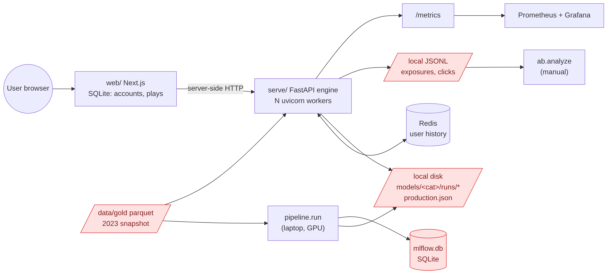
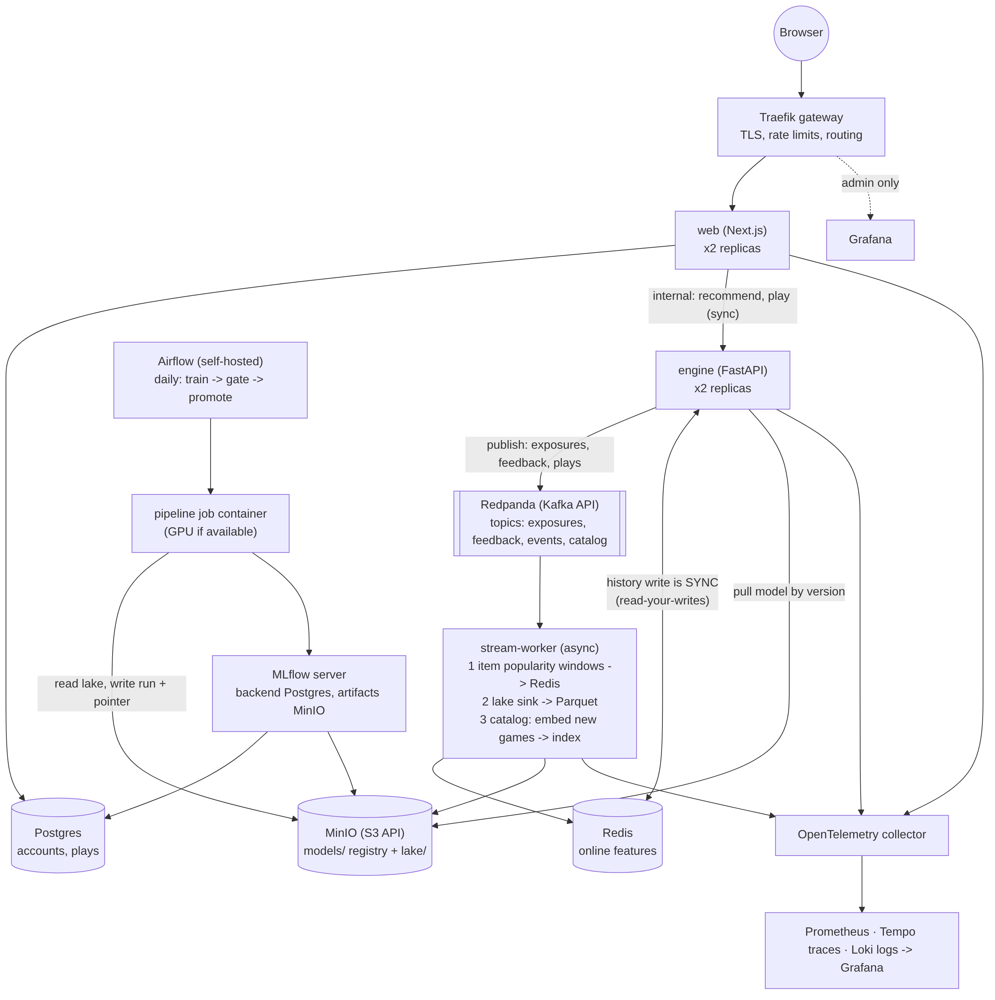
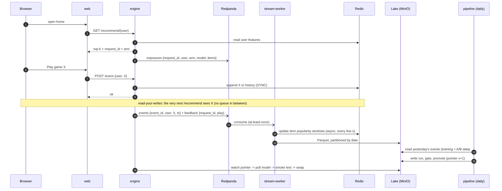
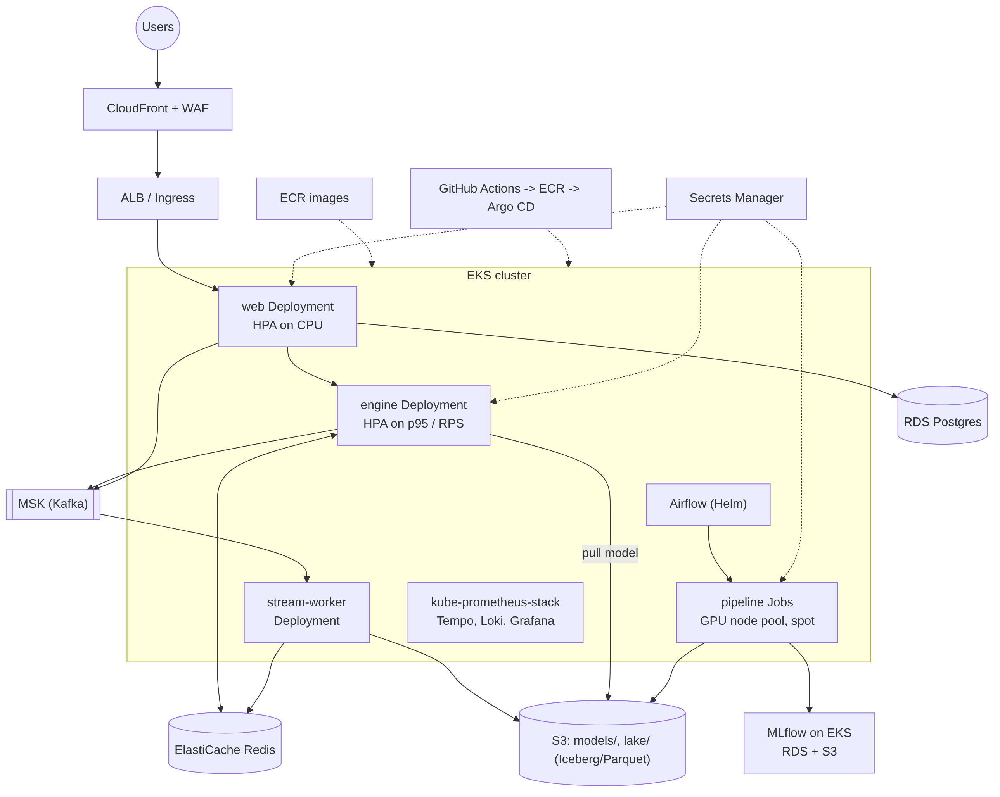

# RecoSphere Platform: Architecture and Productionization Plan

**Status:** design v1 · **Scope:** RecoSphere Play (web) + RecoSphere engine + data/ML pipeline
**Principle:** *local mirrors production.* We build and run everything locally first, using the same
container images, the same protocols (Postgres, S3 API, Kafka API, OpenTelemetry), and only swap the
backing service per environment. Going to the cloud should be a configuration change, not a rewrite.

---

## 1. What exists today (as built)

| Component | Today | Fine for |
|---|---|---|
| `web/` Next.js | SQLite file, 1 process | one laptop |
| `serve/` engine | FastAPI, N workers, Redis or in-memory store | one machine |
| Models | `models/<cat>/runs/*` + `production.json` on **local disk** | one machine |
| A/B data | `exposures-<pid>.jsonl`, `clicks-<pid>.jsonl` on **local disk** | offline analysis |
| Training | `python -m pipeline.run` on a laptop GPU, MLflow in **SQLite** | one person |
| Data | `data/gold/*.parquet`, a **2023 snapshot**; the engine clock is frozen at the start of the test window | offline research |
| Monitoring | Prometheus + Grafana + 6 alerts | ✅ already production-shaped |

The red boxes in the diagram are state that lives on one disk. Each one blocks running a second machine.

## 2. Gap analysis: what breaks in production

Ordered by how early it hurts.

| # | Gap | What breaks | Severity |
|---|---|---|---|
| G1 | Models on local disk | A second engine host has no models; promotion means copying files by hand | blocker |
| G2 | App DB is SQLite | Two web replicas means two different user tables | blocker |
| G3 | A/B logs are per-process JSONL on local disk | Logs die with the container; no central place to analyse; no stream | blocker |
| G4 | Frozen clock + static item state | Popularity, "new", and recency features never move; the catalog never grows | blocker for a live product |
| G5 | The feature store is bootstrapped by the API at startup (loads all users from parquet) | Startup time grows with users; at millions of users the API should not own data loading | high |
| G6 | Training runs on a laptop and reads a local snapshot | Training does not see what users did yesterday, so the replay's "retrain often" finding cannot be acted on | high |
| G7 | No gateway | No TLS, no rate limits, the engine is reachable directly | high |
| G8 | No tracing, unstructured logs | A slow request cannot be followed web → engine → Redis | medium |
| G9 | Secrets in `.env` files, a seeded admin password | Fine locally, unacceptable anywhere else | medium (prod only) |
| G10 | New games need a full retrain to be embedded | A game launched today has no embedding until the next pipeline run | medium |

## 3. Target architecture (local, production-shaped)

| Service | Role | Local | Production (AWS) | Production (GCP) |
|---|---|---|---|---|
| gateway | TLS, routing, rate limits, admin-only routes | Traefik | CloudFront + WAF + ALB | Cloud CDN + Cloud Armor + LB |
| web | product UI, accounts, sessions | container ×2 | EKS Deployment (HPA) | GKE Deployment |
| engine | recommend, explain, catalog, event intake | container ×2 | EKS Deployment (HPA on RPS/p95) | GKE |
| app DB | accounts, plays, sessions | Postgres | RDS Postgres | Cloud SQL |
| online feature store | user history, item popularity windows | Redis | ElastiCache | Memorystore |
| event bus | exposures, feedback, plays, catalog | Redpanda (Kafka API) | MSK | Pub/Sub (or Confluent) |
| stream-worker | popularity windows, lake sink, new-game embedding | container | EKS Deployment | GKE |
| object storage | model registry + data lake | MinIO (S3 API) | S3 | GCS |
| training | `pipeline.run` as a job | container (GPU if available) | EKS Job on a GPU spot node pool | GKE Job / Vertex custom job |
| orchestration | daily train → gate → promote; backfills | Airflow (self-hosted) | Airflow on EKS (or MWAA) | Airflow on GKE (or Composer) |
| experiment tracking | runs, params, metrics | MLflow server (Postgres + MinIO) | MLflow on EKS (RDS + S3) | MLflow on GKE |
| observability | metrics, traces, logs | Prometheus, Tempo, Loki, Grafana via an OTel collector | same stack (kube-prometheus-stack) | same |
| secrets | credentials, tokens | `.env` (dev only) | Secrets Manager | Secret Manager |
| CI/CD | test, build, deploy | GitHub Actions | Actions → ECR → Argo CD | Actions → Artifact Registry → Argo CD |

**Why self-hosted versions (Airflow, MLflow, Prometheus stack) and not managed ones?** The same Helm charts
run on a laptop (kind) and in the cloud, there is no lock-in, and every piece is something we understand
and can debug. Managed alternatives are listed so the trade-off is visible: less ops work in exchange for
cost and less control.

## 4. The core loop: from a play to a better model

Two speeds, on purpose:

| Path | Latency | What it carries | Consistency |
|---|---|---|---|
| **Synchronous** (web → engine → Redis) | ms | the user's own history (the play just made) | read-your-writes: the next home page already reflects it |
| **Asynchronous** (engine → Kafka → stream-worker) | seconds | item popularity, the lake, new-game embeddings | eventual; at-least-once delivery, deduplicated by `event_id` |
| **Batch** (lake → Airflow → pipeline) | daily | model weights | gated: the paired bootstrap gate decides, and a hot swap deploys |

*Design note (caught while drawing the sequence):* the first draft routed plays through Kafka before they
reached Redis. A user who plays a game and goes straight back home would then see a stale feed: the one
behaviour the app demo depends on. History writes stay synchronous; Kafka is for everything downstream.

## 5. Production target (AWS)

## 6. Architecture decisions (ADRs)

**ADR-1: Local mirrors production.** Each environment runs the same images; only connection strings differ
(12-factor config). *Trade-off:* local runs more containers (~12) than a pure dev setup needs. Mitigated
with compose profiles (`core`, `stream`, `ml`, `obs`).

**ADR-2: Postgres for the app DB.** Multiple web replicas, real migrations, row locking for sessions/plays.
*Trade-off:* one more service locally; SQLite stays possible for quick UI work via `DATABASE_URL`.

**ADR-3: Object storage is the model registry.** A run is an immutable prefix `models/<cat>/runs/<run_id>/`.
Production is a small versioned pointer object `models/<cat>/production.json`, holding the run id, a
monotonically increasing version, and a checksum. Engines poll the pointer, download the run to a local
cache, verify the checksum, smoke-test it, then swap (the 7d logic, unchanged). *Why not the MLflow Model
Registry?* Our "model" is 7 files across two frameworks plus a FAISS index, and the gate and rollback
semantics already exist. MLflow stays the experiment tracker. *Trade-off:* we own the pointer semantics
(already tested, including the replay incident's guard).

**ADR-4: Kafka API event bus (Redpanda locally).** Topics: `exposures`, `feedback`, `events` (plays),
`catalog`. Every message carries `event_id`, `schema_version`, `ts`, `user_id`, `request_id` where it
applies. *Why a bus instead of the engine writing to the lake directly?* Decoupling (the engine never waits
on S3), replay (rebuild any consumer from the log), several consumers of one fact (lake, popularity,
analytics). *Trade-off:* at-least-once delivery means consumers must be idempotent. The lake sink dedups
on `event_id`. Redpanda locally because it is one binary with no ZooKeeper, and its Kafka API is
wire-compatible with MSK.

**ADR-5: Synchronous history writes, asynchronous everything else.** See §4. *Trade-off:* the engine does
two writes per play (Redis, then Kafka). If the Kafka publish fails, the user experience is unaffected;
the event goes to a local retry buffer and a `events_publish_failed_total` counter, with an alert.

**ADR-6: Real time instead of a frozen clock.** `t_ref = now()`. Item popularity windows (30/90/365 days,
trend) move out of the API's startup and into Redis, maintained by the stream-worker from the `events`
topic and reconciled nightly from the lake. User-recency features use real timestamps. *Risk:*
training/serving skew in time features. *Mitigation:* the pipeline computes the same features "as of" each
training cutoff from the lake. The parity test grows a "time" case.

**ADR-7: The pipeline owns the feature store bootstrap, not the API.** A batch step writes user histories
and item state into Redis (versioned key prefix + atomic switch). The API only reads and appends. Fixes
G5.

**ADR-8: New games without retraining.** A `catalog` message (new game) → the stream-worker computes the
MiniLM text embedding → runs the item tower in content-only mode (the ID embedding is zero, exactly how
cold items are served today) → adds the vector to the live index (Flat supports `add`) → publishes an
`index_delta`. Engines apply deltas between full model swaps. This turns the "46% of demand is new
items" finding into a same-day capability.

**ADR-9: Gateway in front, engine private.** Only Traefik/ALB is exposed. The engine and Redis sit on an
internal network. Admin routes need a role claim. Rate limits per IP and per user on login and `/api/*`.

**ADR-10: OpenTelemetry everywhere.** One trace id from the browser request through web → engine → Redis
and Kafka produce. Grafana links Prometheus exemplars to Tempo traces. JSON logs to Loki carry the trace
id.

**ADR-11: Kubernetes last, not first.** Compose until the system is functionally complete. Then Helm
charts run on kind locally, and the same charts deploy to EKS. *Trade-off:* the compose files and charts
have to be kept in sync for a while; worth it because debugging stays easy while features are added.

## 7. Build plan: local first

Each phase ends with a demo and an automated check. Nothing moves to the next phase on "it works on my
machine".

| Phase | Builds | Fixes | Definition of done |
|---|---|---|---|
| **P0 Foundation** | repo layout (`services/`, `infra/`), compose profiles, `Makefile`, `.env` templates, push `web/` | — | `make up` starts the current system; CI green on GitHub |
| **P1 Postgres** | app DB on Postgres with migrations; SQLite kept for quick dev | G2 | two web replicas behind the gateway share sessions; e2e passes |
| **P2 Model registry on MinIO** | pipeline publishes runs + versioned pointer to S3; engine pulls, verifies checksum, caches, swaps | G1 | promote on one machine → two engine replicas swap with 0 failed requests under load |
| **P3 Event bus** | Redpanda; engine publishes exposures/feedback/events with `event_id`; lake sink → Parquet (date-partitioned) on MinIO; `ab.analyze` reads the lake | G3 | 0 lost events across an engine restart; A/B report from the lake matches the JSONL report |
| **P4 Real time** | real clock; popularity windows in Redis from the stream; feature store bootstrap moves to the pipeline | G4, G5 | play a game 50× from simulated users → it climbs "Trending" within a minute; parity test incl. time |
| **P5 Daily retraining** | pipeline reads the lake; Airflow + MLflow server (Postgres + MinIO) in compose; replay runs as a backfill | G6 | Airflow run trains on yesterday's simulated plays → gate → promote → engines swap |
| **P6 New games same day** | catalog topic → embed → index delta → engines | G10 | add a new game via the admin UI → it appears in "New releases" and in relevant users' candidates without a retrain |
| **P7 Gateway + security** | Traefik (local TLS), rate limits, internal networks, role-based admin, secrets via env/files | G7, G9 | engine unreachable from the host network; login brute-force gets rate limited |
| **P8 Observability** | OTel SDKs in web/engine/worker, collector, Tempo, Loki, trace-linked dashboards | G8 | one click from a slow-request alert to its trace |
| **P9 Kubernetes (kind) + Helm** | charts for every service, HPA, PodDisruptionBudgets, readiness = smoke test | — | `helm install` on kind; rolling engine upgrade with 0 errors |
| **P10 Cloud (later)** | Terraform for VPC/EKS/RDS/ElastiCache/MSK/S3, Argo CD | — | same charts on EKS; staging environment |

**Recommended order of work:** P0 → P1 → P2 → P3 → P4. That is the minimum for "a real, multi-instance,
live-updating platform". P5–P8 make it operable. P9–P10 make it deployable anywhere.

## 8. Non-functional targets (local load test, then cloud)

| | Target | Measured today |
|---|---|---|
| Home page (all rows, server-side) | p95 < 300 ms | ~50–70 ms of engine calls on synthetic data (not yet on real data) |
| `/recommend` | p95 < 50 ms per engine replica under load | 7.7 ms single request; ~430 RPS per worker at p95 32 ms (real data, laptop) |
| Play → visible in the feed | next page load (synchronous) | ✅ (e2e) |
| Play → popularity / trending | < 60 s | not built (P4) |
| Model promotion → all replicas | < 60 s, 0 failed requests | ~2 s, 0 errors (synthetic, 2 workers) |
| Event loss | 0 (at-least-once + dedup) | logs are lost with the container today (P3) |
| Availability | engine down → app still renders popular rows | partly: the engine falls back on errors, but the app shows an error if the engine is unreachable (fix in P1: cached fallback) |

## 9. Open questions (to decide before the phase that needs them)

1. **Cloud:** AWS (the original plan, S3/PySpark) or GCP? The design is portable; it only matters at P10.
2. **Schema registry** for Kafka (Avro/Protobuf) or JSON + `schema_version`? Proposal: JSON + version for
   P3, revisit if more than 2 producers appear.
3. **Lake table format:** plain Parquet partitions (simple) or Iceberg (time travel, compaction)? Proposal:
   Parquet in P3, Iceberg only if the replay needs table time travel.
4. **GPU for daily training** locally: the laptop GPU via Docker (`--gpus all`, needs WSL2 + NVIDIA
   Container Toolkit) or CPU in containers with fewer epochs?
