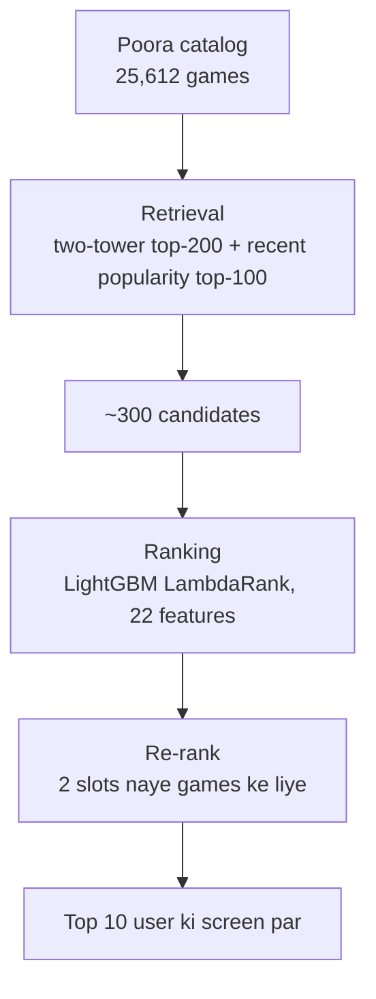
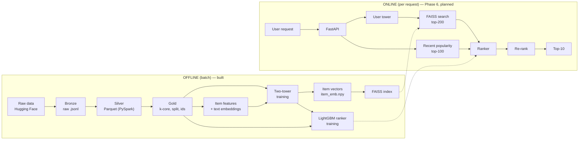
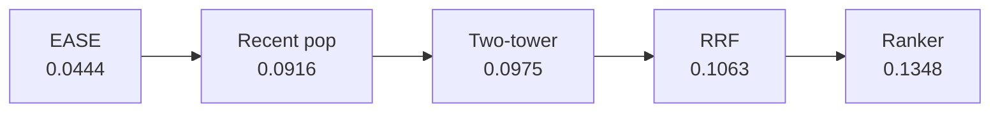

# RecoSphere (RankForge): Architecture aur Approach, simple shabdon mein

> Ye document poore project ko shuru se samjhaata hai: **problem kya hai, data kya hai, system kaise bana hai, aur har phase mein kya kiya, kyun kiya, aur kya mila.**
> Saare numbers project ke apne runs se hain (Video_Games category, L1). Koi number assume nahi kiya gaya.

---

## Table of contents

1. [Problem ek line mein](#1-problem-ek-line-mein)
2. [Data: kya hai, kahan se aaya, kaisa hai](#2-data-kya-hai-kahan-se-aaya-kaisa-hai)
3. [Poora approach: funnel](#3-poora-approach-funnel)
4. [Architecture: offline aur online](#4-architecture-offline-aur-online)
5. [Phase by phase](#5-phase-by-phase)
6. [Final scoreboard](#6-final-scoreboard)
7. [Honest limitations](#7-honest-limitations)
8. [Aage kya](#8-aage-kya)
9. [Glossary](#9-glossary-simple-shabdon-mein)

---

## 1. Problem ek line mein

**Ek online dukaan mein hazaron video games hain. Har customer ko sirf 10 aise games dikhane hain jo wo sach mein kharidega, aur ye ek second se bhi kam mein karna hai.**

Isko **recommendation system** kehte hain: Amazon ka "Recommended for you", YouTube ka home page, Netflix ki rows.

### Ye mushkil kyun hai

| Mushkil | Simple matlab | Hamare data mein |
|---|---|---|
| **Scale** | Har user ke liye har game check karna slow hai | 25,612 games (L1), aage 1.6M tak (L3) |
| **Sparsity** | Zyaadatar logon ne bahut kam kharida hai | 96%+ users ke 5 se kam reviews |
| **Naye games (cold start)** | Naye game ka koi purchase history nahi | Test ke **46.2%** interactions naye games par |
| **Time badalta hai** | Purane hit games ab koi nahi leta | Sabse strong simple tareeka "jo abhi trending hai" nikla |
| **Speed** | Page ~100 ms mein load hona chahiye | Retrieval step ka budget: p95 ≤ 5 ms |

---

## 2. Data: kya hai, kahan se aaya, kaisa hai

### 2.1 Source

**Amazon Reviews 2023** (UCSD McAuley Lab, Hugging Face par public). Hum **Video_Games** category use kar rahe hain.

Do files hain:

| File | Ek row ka matlab | Kaam |
|---|---|---|
| `Video_Games.jsonl` (reviews) | "User X ne date D par game Y ka review likha" | Interactions: kisne kya liya |
| `meta_Video_Games.jsonl` (metadata) | "Game Y ka title, features, category, publisher..." | Games ko samajhna, naye games ke liye zaroori |

**Ek important assumption:** review = user ne game kharida ya khela. Star rating ko label ki tarah use nahi kiya. 1-star review bhi batata hai ki user ne game liya tha. Ise **implicit feedback** kehte hain. Asli Amazon click/purchase data public nahi hai, reviews uska sabse kareebi public version hain.

### 2.2 Raw data kaisa hai

| Cheez | Value |
|---|---|
| Raw review rows | 4,624,615 |
| Corrupt rows | 0 |
| Exact duplicates (same user, product, time) | 53,648 |
| Saaf interactions (Silver) | 4,570,967 |
| Users | 2,766,656 |
| Games (`parent_asin`) | 137,249 |
| Product variants (`asin`) | 167,645 |
| Time range | Nov 1998 → Sep 2023 |
| Timestamp unit | **milliseconds** (seconds mein convert kiya) |

**`parent_asin` kyun?** Ek game ke alag variants (jaise alag edition ya platform) ke alag `asin` hote hain, lekin `parent_asin` ek hi hota hai. Metadata bhi `parent_asin` par juda hai, isliye game = `parent_asin`.

### 2.3 Metadata ki quality

| Field | Khaali/missing | Use |
|---|---|---|
| title | 0.01% | **Main text input**, lagbhag hamesha mojood |
| categories | 9.21% | Text input |
| features | 28.77% | Text input (jahan ho) |
| description | 37.69% | Text input, sirf pehle 200 characters |
| store (publisher) | 3.18% | Categorical feature |
| price | 54.85% parse nahi hota | **Use nahi kiya** |
| Coverage | 100% games ke paas metadata | |

`details` field ke andar useful keys: **Date First Available** (93.6% games), Manufacturer (84.1%), Type of item (55.0%), Rated/ESRB (30.2%), Release date (25.6%).

### 2.4 Snapshot leakage: ek bada trap

Metadata **2023 mein** scrape hua tha, isliye har field game ki **2023 wali state** batata hai. Hum model ko 2019 tak ka data dikha ke 2021–23 predict karwa rahe hain. Agar "Best Sellers Rank" ya "rating_number" feature mein daalte, to model ko future ki popularity pehle se pata hoti, jaise exam se pehle answer key dekh lena.

| Use kiya (listing ke time fixed) | Use **nahi** kiya (time ke saath badalta hai) |
|---|---|
| Title, categories, features, description | Best Sellers Rank |
| Publisher, Type of item, ESRB rating | rating_number, average_rating |
| Date First Available | Price, Is Discontinued |

Popularity jaise features hum **apne interactions se, sirf cutoff se pehle ke data par** banate hain.

### 2.5 Data layers (Bronze → Silver → Gold)

| Layer | Kya hai | Analogy |
|---|---|---|
| **Bronze** | Original `.jsonl` files, kabhi edit nahi hoti | Original receipt ki photocopy |
| **Silver** | Typed, validated, Parquet (zstd), saal ke hisaab se partitioned | Receipt se bani saaf Excel sheet |
| **Gold** | Model-ready: k-core, train/val/test split, integer IDs, item features | Recipe ke liye naap-tol ke rakhe ingredients |

Bronze kabhi nahi badalta. Cleaning mein bug nikle to Silver dobara ban sakta hai, source download kiye bina.

---

## 3. Poora approach: funnel

Har user ke liye har game par ek heavy model chalana bahut slow hai. Isliye industry ek **funnel** banati hai: pehle sasta aur tez filter, phir mehenga aur precise model sirf bache hue items par.



| Stage | Kaam | Analogy | Metric |
|---|---|---|---|
| **Retrieval** | Hazaron mein se ~300 kaam ke games tezi se nikaalna | HR screening | Recall@100 (sahi game list mein aaya?) |
| **Ranking** | 300 ko dhyan se, zyada jaankari ke saath order karna | Interview panel | NDCG@10 (sahi game kitna upar?) |
| **Re-rank** | Business rules: variety, naye games ko jagah | Final manager approval | Coverage, new-item share |

**Bina history wale users** (test ke 13.5%) ke liye personalization possible nahi, unhe **pichle 30 din ke popular games** dikhate hain.

### Achha hai ya nahi, kaise pata chalta hai

**Temporal split:** model ko sirf past dikhate hain aur future par test karte hain. Random split se future ka data training mein leak ho jaata aur numbers jhoothe achhe aate.

```
|------------- Train (1999 → Dec 2019) -------------|-- Val (→ Jul 2021) --|-- Test (→ Sep 2023) --|
            model yahi dekhta hai                      tuning yahan           sirf ek baar, end mein
```

- **Recall@100:** user ko 100 games dikhaye. Test period mein usne jo games sach mein kharide, unme se kitne list mein the?
- **NDCG@10:** sahi games top-10 mein kitne upar aaye? Upar wale hit ko zyada credit milta hai.
- **Warm / cold slice:** jo games history mein the vs bilkul naye games, dono alag naape jaate hain.
- Jo games user pehle le chuka hai, wo list se hata diye jaate hain (masking).

Har model **same metric code** (`eval/metrics.py`) se, **same test set** par naapa gaya, isliye saare numbers seedhe comparable hain.

---

## 4. Architecture: offline aur online

System ki do duniya hain:
- **Offline (batch):** roz/hafte mein ek baar chalta hai. Data saaf karna, models train karna, index banana.
- **Online (har request):** milliseconds mein chalta hai. User aaya, uske liye top-10 banao.



### Code ka structure

```
RecoSphere/
├── data/                  bronze/, silver/, gold/  (git mein nahi)
├── notebooks/
│   ├── 01_data_ingestion_research   Raw → Bronze → Silver (PySpark)
│   ├── 02_prepare_and_split          Silver → Gold (PySpark + Polars cross-check)
│   ├── 03_two_tower                  Retrieval model + ablations
│   ├── 04_ann_faiss                  FAISS index benchmark
│   ├── 05_ranker                     Candidates + LightGBM ranker
│   └── 06_beyond_accuracy            Coverage, bias, segments, re-rank, fallback
├── baselines/models.py     Popularity, ItemKNN, EASE
├── eval/metrics.py         Recall@K, NDCG@K, warm/cold slices (sabka ek hi metric code)
├── retrieval/two_tower.py  Two-tower model + training (notebooks aur serving dono use karte hain)
├── ranking/pipeline.py     Candidates + 22 features (notebooks aur serving dono use karte hain)
├── run_baselines.py
├── models/                 two_tower.pt, item_emb.npy, faiss.index, ranker.txt, serving_policy.json
└── results/                Har phase ki tables (.csv / .md)
```

**Ek design principle:** model aur feature ka code **ek hi jagah** (`retrieval/`, `ranking/`) rehta hai. Notebook aur serving dono wahi import karte hain. Isse **training-serving skew** nahi hota, yaani training aur production mein features alag tareeke se calculate nahi hote.

---

## 5. Phase by phase

Har phase ka format: **kya kiya → kyun → kaise → result → seekh.**

### Phase 0a: Data ingestion (notebook 01)

**Kya kiya:** Raw files ko Bronze mein rakha, phir PySpark se padh ke Silver Parquet banaya.

**Kyun:** Raw JSON slow hai, usme type ki galtiyan hoti hain, aur bahut saari faltu cheezein hain (review text, image URLs).

**Kaise (step by step):**
1. Hugging Face se plain `.jsonl` download kiya, `.gz` nahi. Gzip splittable nahi hota, Spark use sirf ek core par padhta.
2. **Explicit schema** diya, `inferSchema` nahi. Ye fast aur deterministic hai, aur kharab rows `_corrupt_record` mein gini jaati hain.
3. Data ko chhe sawaalon se profile kiya: schema, quality, time, duplicates, sparsity, metadata coverage.
4. Timestamp ka unit apne aap detect kiya (ms) aur seconds mein convert kiya.
5. Sirf **exact duplicates** hataye. Repeat (user, game) ko rakha, kyunki unhe hatana modeling decision hai, cleaning nahi.
6. Review text aur images drop kiye (sabse bhaari columns, abhi kisi model ko nahi chahiye).
7. Silver ko zstd Parquet mein, `event_year` partitions ke saath likha, aur counts validate kiye.

**Result:** 4,624,615 raw → 0 corrupt → 53,648 exact duplicates hate → **4,570,967** Silver interactions, 137,269 products.

**Seekh:** Windows par Spark ke liye Java aur Hadoop (`winutils`) ka setup chahiye. Iske liye WSL2 behtar raasta hai.

### Phase 0b: Prepare + split (notebook 02)

**Kya kiya:** Silver se model-ready Gold banaya.

**Kaise:**
1. **Implicit feedback decision:** saare reviews positive maane. Verified-only lene se 5-core ke baad ~33% data kam ho jaata (545,757 vs 814,586).
2. **Dedup:** same (user, game) ke kai reviews mein se sabse pehla rakha. Isse 15,467 rows hatin.
3. **Iterative 5-core:** har user aur har game ke kam se kam 5 interactions. Users hatane se games ka count girta hai, aur games hatane se users ka, isliye ye loop tab tak chala jab tak sab stable na ho gaya (7 iterations). Spark mein har iteration ke baad `localCheckpoint()` kiya, warna query plan har loop ke saath bada hota jaata.
4. **Global temporal split:** sab users ke liye ek hi cutoff, interactions ke hisaab se 80/10/10.
5. **Integer IDs:** 0..N-1. Mapping **poore** k-core par bani, taaki test ke naye games ko bhi ID mile.

**Result:**

| Step | Interactions | Users | Games |
|---|---|---|---|
| Silver | 4,570,967 | 2,766,656 | 137,249 |
| Dedup | 4,555,500 | 2,766,656 | 137,249 |
| **5-core** | **814,586** | **94,762** | **25,612** |
| (10-core, compare ke liye) | 196,508 | 11,658 | 5,335 |

| Split | Interactions | Time |
|---|---|---|
| Train | 651,591 | → 9 Dec 2019 |
| Val | 81,455 | → 9 Jul 2021 |
| Test | 81,540 | → Sep 2023 |

**Teen independent checks:**
- Hamara 5-core McAuley Lab ke **official 5-core benchmark se exactly match** karta hai: 814,586 rows, aur (user, game) pairs mein `ours_only = 0`, `bench_only = 0`.
- Polars wala alag implementation same k-core aur same ID maps deta hai.
- Train + val + test = k-core rows, aur time order strict hai.

**Cold-start ka size (sabse important finding):**

| Window | Naye games par interactions |
|---|---|
| Val (history = train) | 27.2% |
| Test (history = train) | 68.2% |
| **Test (history = train + val)** | **46.2%** |

**Seekh:**
- 5-core sirf **3.43% users** rakhta hai. Hamara offline eval "active users" ko measure karta hai, aur ye limitation honestly bolni hai.
- Catalog bahut tezi se purana hota hai: val period ka data jodne se hi test ka cold share 68% se 46% par aa gaya. Ye **regular retraining** ka data-backed argument hai.
- Eval windows lambi hain (val ~19 mahine, test ~26 mahine), kyunki 5-core ke baad recent saalon mein data patla hai.

### Phase 1: Baselines

**Kya kiya:** Teen simple tareeke, jo aage ke har model ke liye "minimum passing marks" hain.

| Baseline | Kya karta hai |
|---|---|
| Popularity (all-time) | Sabko sabse zyada bike games |
| **Recent popularity** | Sabko history ke **last 10%** time mein sabse zyada bike games |
| ItemKNN | "Jinhone X liya, unhone Y bhi liya" |
| EASE | ItemKNN ka smarter version: ek closed-form formula, sirf top-20k items par (cost O(items³) hai) |

**Protocol:** hyperparameters val par tune hue, best config train+val par refit hua, aur test par sirf ek baar eval hua.

**Result (test):**

| Model | Recall@100 | NDCG@10 | Warm R@100 | Cold R@100 |
|---|---|---|---|---|
| Popularity | 0.0239 | 0.0040 | 0.0379 | 0 |
| **Recent popularity** | **0.0916** | **0.0102** | **0.1441** | 0 |
| ItemKNN (k=200) | 0.0321 | 0.0056 | 0.0515 | ~0 |
| EASE (λ=500) | 0.0444 | 0.0075 | 0.0702 | 0 |

Random guessing ka Recall@100 lagbhag 100 / 25,612 ≈ 0.004 hota, to saare baselines usse kaafi upar hain.

**Seekh:**
- **Sabse simple tareeka jeeta.** Recent popularity ne EASE ko ~2x se hara diya. Is data mein **time drift** sabse bada signal hai: video games mein naye launch hi bikte hain.
- ID-based models naye games ko **kabhi** recommend nahi kar sakte (cold recall = 0). Unki hard ceiling test ka ~54% hai.

### Phase 2: Two-tower retrieval (notebook 03)

**Kya kiya:** Ek neural model jo har user aur har game ko 64 numbers ke vector mein badalta hai. Score = dono vectors ka dot product.

**Design (har decision pichle findings se aaya):**

| Finding | Design decision |
|---|---|
| 46% demand naye games ki hai | **Item tower mein text**: title + categories + features + description, MiniLM se 384 numbers. ID ke bina bhi naye game ko vector milta hai |
| ID embedding text ko dabaa deti hai | **ID dropout 50%** training mein. Eval mein naye games ki ID embedding **zero** |
| Naye users | **User ID nahi**, user = last 20 games ka weighted average (recent ko zyada weight) |
| Popular games batches mein zyada aate hain | **In-batch negatives + logQ correction** |
| Recency strong hai | Item **age** feature, ek ablation ki tarah |

**Leakage guard:** har training example ki history uske target se strictly pehle ki hai, aur ye `assert` se check hota hai.

**Result (test, 4 ablations):**

| Variant | Recall@100 | NDCG@10 | Warm R@100 | Cold R@100 |
|---|---|---|---|---|
| ID only | 0.0841 | 0.0131 | 0.1327 | 0 |
| Content only | 0.0953 | 0.0144 | 0.1178 | **0.0547** |
| **ID + content** | **0.0975** | **0.0146** | 0.1327 | 0.0378 |
| ID + content + age | 0.0774 | 0.0111 | 0.1057 | 0.0291 |

**Seekh:**
- Two-tower ne EASE ko ~2.2x hara diya, aur recent popularity ko **NDCG@10 par +43%**. Recall@100 par farak chhota hai (+6%, ek seed).
- **Pehli baar naye games par non-zero recall aaya**, kyunki text tower kaam kar gaya.
- Lekin **warm games par recent popularity abhi bhi best** thi (0.1441 vs 0.1327). Matlab two-tower ki jeet poori tarah naye games se aayi.
- ID + content mein **trade-off** hai: ID jodne se warm recall badha, lekin cold recall gira.
- **Age feature ne har slice par nuksaan kiya.** Diagnosis: in-batch negatives ki age unke **apne** purchase time par nikalti thi, isliye training mein batch ka har game "naya" dikhta tha aur age se positive aur negative mein farak hi nahi padta tha. Eval mein age ek fixed time par nikalti hai, to distribution badal gaya. **Decision: recency ko tower se nikaal ke ranker mein daala.**

### Phase 3: ANN with FAISS (notebook 04)

**Kya kiya:** User vector se sabse kareeb 200 games nikaalne ke chaar tareeke compare kiye.

| Index | Analogy |
|---|---|
| Flat (exact) | Library ki har kitaab dekho |
| HNSW | Doston ke doston se poochte-poochte pahuncho (graph) |
| IVF | Sirf sabse relevant shelves dekho |
| IVF-PQ | IVF + har kitaab ka chhota summary (compression) |

**Consistency checks (sab pass):**
- Item vectors dobara banaye aur saved file se match kiye: max diff 1.79e-07. Ye production ka "embedding version mismatch" bug pakadne wala check hai.
- Full brute force = notebook 03 = Flat@200 = **0.0975**.

**Result (L1, 25,612 games):**

| Index | Index recall | End-to-end Recall@100 | p95 latency | Memory |
|---|---|---|---|---|
| **Flat** | 1.000 | 0.0975 | 0.36 ms | 6.6 MB |
| HNSW (ef=200) | 0.986 | 0.0976 | 0.38 ms | 13.5 MB |
| IVF (nprobe=64) | 0.968 | 0.0963 | 0.13 ms | 6.8 MB |
| IVF-PQ (nprobe=64) | 0.844 | 0.0927 | 0.14 ms | **0.76 MB** |

**Choice rule:** 5 ms latency budget ke andar jo sabse accurate ho. L1 par **Flat** chuna gaya, kyunki is scale par exact search pehle se sub-millisecond hai.

**Seekh:**
- **Index recall ek proxy hai.** HNSW ka index recall 98.6% tha, phir bhi end-to-end Recall@100 bilkul nahi gira. ANN jo items miss karta hai, wo zyaadatar wo hote hain jo user waise bhi nahi leta.
- Synthetic 500k vectors par (sirf method demo, result nahi): Flat ki p95 9.9 ms ho gayi, jo budget se bahar hai. IVF-PQ ka recall `nprobe` badhane se bhi ~0.6 par atak gaya, kyunki bottleneck **compression** hai, search nahi. L2 (747.8k games) par ANN zaroori hoga.

### Phase 4: Candidates + ranker (notebook 05)

**Kya kiya:** Do sources se candidates liye, unhe ek LightGBM ranker se order kiya.

**Kaise:**
1. **Train-only two-tower:** ranker ko val window par train karna hai, isliye uske candidates ek aise model se aane chahiye jisne val nahi dekha. Saved model train+val par bana tha, to isliye ek alag model sirf train par banaya.
2. **Candidates:** two-tower top-200 + recent popularity top-100, dono ka union (~300 per user).
3. **22 features**, sab cutoff se pehle ke data se:

| Group | Features |
|---|---|
| Retrieval | two-tower score/rank, popularity rank, kis source se aaya |
| Game | popularity (all-time, 30/90/365 din), trend, age (Date First Available se), publisher, type, ESRB |
| User | kitne games liye, last activity kab, kitne time se active, average rating |
| User × game | is publisher ka user ki history mein share, game ka text user ki history se kitna milta hai |

4. **LightGBM LambdaRank:** seedha order (NDCG) optimize karta hai. Val window par train hua, apne early stopping ke saath.

**Protocol:**

| | Retrieval model | Features ki history | Labels |
|---|---|---|---|
| Ranker train | train-only | train | val |
| Ranker test | train+val | train+val | test |

**Sanity checks (dono pass):** sirf two-tower order = **0.0975** (notebook 03 jaisa), sirf recent-pop order = **0.0916** (baseline jaisa).

**Result (test):**

| Ordering | Recall@100 | NDCG@10 | Warm R@100 | Cold R@100 |
|---|---|---|---|---|
| Two-tower | 0.0975 | 0.0146 | 0.1327 | 0.0378 |
| Recent popularity | 0.0916 | 0.0102 | 0.1441 | 0 |
| RRF (bina training ka blend) | 0.1063 | 0.0168 | 0.1556 | 0.0213 |
| **LightGBM ranker** | **0.1348** | **0.0184** | **0.1951** | 0.0282 |

Candidate recall (ranker ki ceiling): two-tower 0.1291, recent pop 0.0810, **union 0.1664**.

**Seekh:**
- Ranker ne two-tower se **Recall@100 +38%** aur **NDCG@10 +26%** diya. EASE se ab ~3x aage hain.
- **Warm games par recent popularity pehli baar haari** (0.1951 vs 0.1441, +35%). Recency ko tower ki jagah ranker features mein daalna sahi decision tha.
- Union ne ceiling ~29% badhayi. Recent popularity ko candidate source banana sahi tha.
- **Naye games par ranker haara** (0.0378 → 0.0282). Ranker val par train hua jahan cold share 27% tha, test par 46% hai, isliye usne "safe" popular games ki taraf jhukna seekh liya.

### Phase 5: Beyond accuracy (notebook 06)

**Kya kiya:** Sirf "kitna sahi" nahi, balki recommendations **kaisi** hain, wo naapa.

**5.1 Variety aur popularity bias (top-10, jo user dekhta hai):**

| Model | Coverage@10 | Gini@10 | Naye games ka share | Top publisher share |
|---|---|---|---|---|
| Recent popularity | 0.07% (~18 games, sabko same) | 0.9996 | 0% | 0.409 |
| Two-tower | **20.2%** | 0.975 | **5.1%** | 0.422 |
| Ranker | 11.1% | 0.994 | 2.4% | **0.358** |

Ranker ne accuracy badhaayi, lekin **catalog coverage aadhi** kar di aur naye games ka exposure bhi aadha kar diya. Har list ke andar publisher variety behtar hai, lekin alag users ki lists zyada milti-julti hain. "List diverse hai" aur "catalog diverse hai" do alag cheezein hain.

**5.2 Segments (user ki history length):**

| History | Users | Recent pop R@100 | Two-tower R@100 | Ranker R@100 |
|---|---|---|---|---|
| 1–2 games | 13.7% | 0.0827 | 0.0835 | **0.1106** |
| 3–5 | 45.5% | 0.0953 | 0.0989 | **0.1362** |
| 6–10 | 26.2% | 0.0942 | 0.1009 | **0.1449** |
| 11–20 | 10.3% | 0.0838 | 0.1026 | **0.1353** |
| 21+ | 4.3% | 0.0824 | 0.0952 | **0.1342** |

Ranker har segment mein jeetta hai, sabse halke users par bhi. Recent popularity heavy users par girti hai, kyunki unhone popular games pehle hi le liye hain.

**5.3 Re-rank rules (ranker ki top-100 → final top-10):**

| Rule | NDCG@10 | Cold recall@10 | Naye games ka share | Coverage |
|---|---|---|---|---|
| Koi rule nahi | 0.0184 | 0.0055 | 2.4% | 11.1% |
| **2 slots naye games ke liye** | **0.0186** | **0.0141 (2.6x)** | **14.2% (~6x)** | **12.5%** |
| Publisher cap 3 | 0.0177 | 0.0043 | 2.0% | 10.3% |
| Dono saath | 0.0182 | 0.0134 | 14.0% | 11.9% |

**Ek simple rule ne ranker ka seekha hua bias theek kar diya:** naye games ka exposure ~6x aur cold recall 2.6x, aur NDCG gira nahi. Publisher cap akele mein sab kuch ghatata hai, wo sirf tab lagao jab business ko publisher variety chahiye.

**5.4 Bina history wale users (fallback):**

| Option | Val Recall@100 (5,234 users) | Test Recall@100 (3,381 users) |
|---|---|---|
| All-time popularity | 0.0492 | 0.0308 |
| Recent popularity (10%) | 0.1064 | 0.0689 |
| **Last 30 days** (val par chuna) | **0.1141** | 0.0652 |
| Last 90 days | 0.1117 | 0.0703 |

Val par chuna gaya option test par sabse upar nahi aaya, lekin options ke beech ka farak bahut chhota hai. Clear baat ye hai ki **all-time popularity bahut kharab hai**: recency yahan bhi sabse bada signal hai.

**Final serving policy:**

| User | Pipeline |
|---|---|
| History hai | Two-tower top-200 + recent pop top-100 → ranker → 2 slots naye games → top-10 |
| History nahi | Pichle 30 din ke popular games |

---

## 6. Final scoreboard

Test set (Jul 2021 → Sep 2023), 21,653 users with history, same metric code:

| Stage | Model | Recall@100 | NDCG@10 |
|---|---|---|---|
| Phase 1 | EASE | 0.0444 | 0.0075 |
| Phase 1 | Recent popularity | 0.0916 | 0.0102 |
| Phase 2 | Two-tower (ID + content) | 0.0975 | 0.0146 |
| Phase 4 | RRF blend | 0.1063 | 0.0168 |
| **Phase 4** | **LightGBM ranker** | **0.1348** | **0.0184** |
| Phase 5 | Ranker + 2 new-item slots | — | 0.0186 |



### Har phase ki ek-line kahani (interview ke liye)

| Phase | Kahani |
|---|---|
| 0 | "Mera k-core official benchmark se exactly match karta hai, aur 46% test demand naye items ki hai. Ye number poore design ko drive karta hai." |
| 1 | "Teen line ka recency heuristic EASE se do guna nikla. Isse samajh aaya ki problem time drift aur naye items ki hai." |
| 2 | "Text-aware item tower ne naye items par pehli baar non-zero recall diya. Item age ko tower mein daalna fail hua, maine wajah dhoondi aur use ranker mein shift kiya." |
| 3 | "Index recall 98.6% par bhi end-to-end metric nahi hila, isliye ANN ko downstream metric se judge karta hoon. L1 par exact search hi kaafi hai." |
| 4 | "Do candidate sources ka union + LambdaRank ne Recall@100 38% aur NDCG@10 26% badhaya. Warm items par recency baseline pehli baar haari." |
| 5 | "Ranker ne coverage aadhi kar di thi. Do slots ke rule ne naye items ka exposure ~6x kiya, bina accuracy khoye." |

---

## 7. Honest limitations

| Limitation | Asar | Kya kar sakte hain |
|---|---|---|
| Reviews ≠ purchases/clicks | Hum purchase ka proxy predict kar rahe hain | Bolna zaroori hai. Stretch: KuaiRand jaisa unbiased dataset |
| 5-core sirf 3.43% users rakhta hai | Eval "active users" ka hai | Light users ka segment analysis kiya (Phase 5) |
| Poore timeline par k-core | Future data decide karta hai kaun bachega (halki leakage) | Official benchmark se comparable rehne ke liye accept kiya |
| Static eval | Test window mein release hue games bhi test start par "available" maane gaye | Monthly rolling-window eval |
| Lambi eval windows (19/26 mahine) | Production (weekly retrain) se pessimistic | Rolling windows |
| Val vs test cold share (27% vs 46%) | Val par chune models naye items ko kam weight dete hain | Phase 5 ke re-rank ne aanshik fix kiya |
| Ek hi seed | Chhote margins pakke nahi | Two-tower ko 3 seeds par chalana pending hai |
| Scale numbers synthetic | ANN trade-off sirf shape hai | L2 (Movies_and_TV) par asli benchmark |

---

## 8. Aage kya

| Phase | Kya banana hai | Measure |
|---|---|---|
| **6. Serving** | FastAPI + Redis (user history, item stats) + Docker. Yahi `retrieval/` aur `ranking/` modules use honge | End-to-end p50/p95 latency, max RPS (Locust) |
| **7. MLOps** | Airflow DAG (retrain + index rebuild), MLflow, GitHub Actions eval gate, Grafana | Retrain time, gate pass/fail history |
| **Scale run** | Same pipeline L2 (Movies_and_TV, 17.3M ratings) → L3 (Electronics, 43.9M) | "4.6M → 43.9M bina rewrite", asli ANN benchmark |
| 8. Stretch | KuaiRand par offline vs unbiased metric | Offline metrics kitne bharosemand hain |

---

## 9. Glossary (simple shabdon mein)

| Term | Matlab |
|---|---|
| **Implicit feedback** | User ne item ke saath interact kiya (kharida/review kiya). "Pasand aaya ya nahi" nahi pata |
| **k-core** | Har user aur har item ke kam se kam k interactions, loop chala ke |
| **Temporal split** | Train = past, test = future. Random split se future leak hota hai |
| **Cold item** | Aisa game jo training history mein kabhi nahi aaya |
| **Warm item** | History mein pehle aaya hua game |
| **Recall@K** | User ke asli games mein se kitne top-K list mein aaye |
| **NDCG@K** | Sahi games top-K mein kitne upar aaye (upar = zyada credit) |
| **Embedding / vector** | Kisi cheez ko numbers ki list mein badalna, taaki "kareebi" naapa ja sake |
| **Two-tower** | Ek tower user ka vector, doosra item ka vector banata hai. Score = dot product |
| **In-batch negatives** | Batch ke doosre users ke asli items ko "galat jawab" maan lena, free mein |
| **logQ correction** | Popular items batch mein zyada aate hain, unke saath insaaf ke liye score se log(popularity) ghatana |
| **ANN** | Approximate nearest neighbour: thodi accuracy chhod ke bahut tez search |
| **Index recall** | ANN ke results mein se kitne exact search ke results jaise hain |
| **LambdaRank** | Ranker ka objective jo seedha order (NDCG) ko optimize karta hai |
| **RRF** | Reciprocal Rank Fusion: do lists ko unke rank ke hisaab se milaana, bina training ke |
| **Coverage** | Catalog ka kitna hissa kabhi recommend hua |
| **Gini** | Exposure kitna asamaan hai (0 = sabko barabar, 1 = sab ek item ko) |
| **Snapshot leakage** | Baad mein liye gaye data (jaise 2023 ki ranking) se past ko predict karna, cheating |
| **Training-serving skew** | Training aur production mein features alag tareeke se calculate hona |
