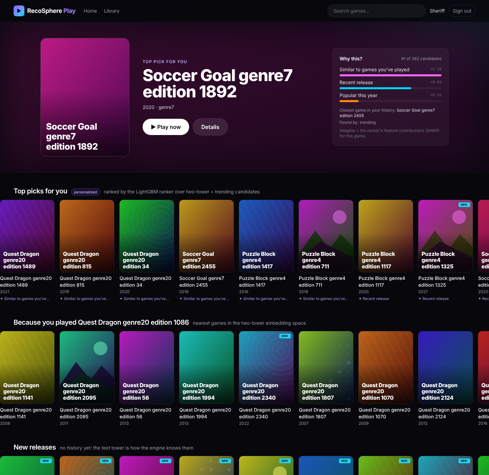
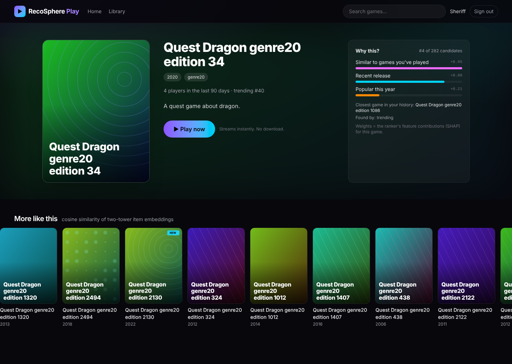
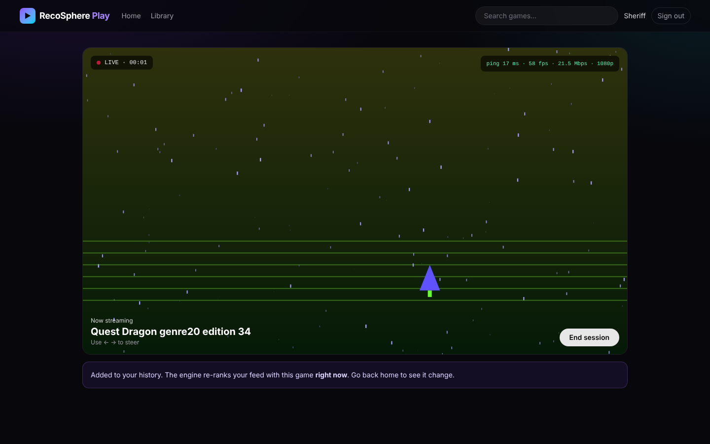
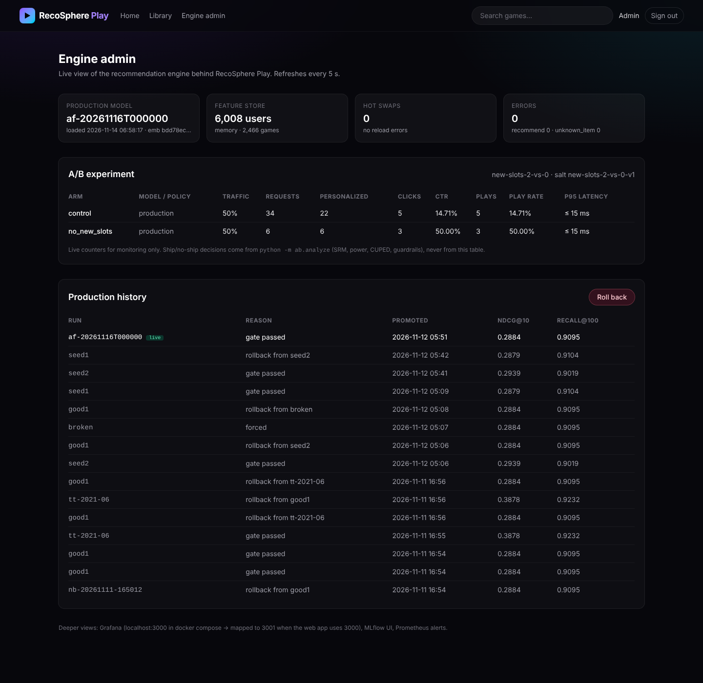

# RecoSphere Play: the product on top of the engine

A cloud-game-streaming storefront (Next.js 15) whose every recommendation, explanation and "Play" goes
through the RecoSphere engine (`serve/`). The streaming itself is simulated; everything else is real.

```
Browser ──▶ Next.js (web/, :3000)                           ──▶ RecoSphere engine (FastAPI, :8000)
            · accounts, sessions, plays (SQLite)                · /recommend (A/B routed, exposure-logged)
            · server components call the engine server-side     · /explain (LightGBM SHAP → reasons)
            · click / play beacons → /api/feedback, /api/play   · /catalog/* (popular, new, search, similar)
                                                                 · /event (play = new history → feed updates)
                                                                 · /admin/summary, /admin/rollback
```

## What the user sees, and what the engine does behind it

| Screen | Engine behind it |
|---|---|
| **Sign up → "What do you like to play?"** (pick ≥3) | each pick = `POST /event` → a brand-new user gets a history; the user tower needs no user ID, so the very next request is personalized |
| **Explore as a real player** | sign in as one of the dataset's real users (offered by `/users/demo`) and see their actual personalized feed |
| **Home: hero + "Top picks for you"** | `/recommend?meta=true` (two-tower + trending candidates → LightGBM → new-item slots), A/B arm by salted hash |
| **"Why this?"** | `/explain`: candidate source, rank among ~280 candidates, top SHAP contributions mapped to plain language, closest game in your history |
| **"Because you played X"** | `/catalog/similar`: nearest items in the two-tower embedding space |
| **New releases / Trending** | `/catalog/popular` (new-only / recent popularity) |
| **Play → stream** | `POST /event` (history changes, so the feed re-ranks instantly) + `/feedback action=play` tied to the exposure's `request_id` |
| **Click a recommended tile** | `sendBeacon` → `/feedback action=click` with `request_id` (A/B outcome) |
| **Engine admin** (admin accounts) | `/admin/summary` (model, hot swaps, experiment, live CTR / play rate / p95 per arm, production history) + **Roll back** → `production.json` → hot swap |

## Run (local)

```powershell
# 1. engine (repo root), with exposure logs + an experiment if you want the A/B table filled
$env:EXPOSURE_DIR="ab_logs"; uvicorn serve.app:app --host 127.0.0.1 --port 8000

# 2. app
cd web
copy .env.example .env.local        # set AUTH_SECRET to any long random string
npm install
npm run dev                          # http://localhost:3000
```

Admin login: `admin@recosphere.dev` / `ADMIN_PASSWORD` from `.env.local` (seeded on first start). Production:
`npm run build && node .next/standalone/server.js` (after copying `.next/static` and `public` next to it,
as the Dockerfile does), or `make up` from the repo root (app on :3000; `make up-all` adds Grafana on :3001).

## Tested (synthetic engine data, Playwright, Chromium)

Every step was run and passed with 0 browser console errors. Screenshots are in the delivery:
- sign up → onboarding (4 picks) → personalized home
- click tile → game page with "Why this?" → Play → back home: top picks changed (3 of the first 8 kept),
  the hero changed, and "Because you played" now points at the game just played
- search, library
- sign out → real-player login → personalized
- admin: A/B table with this session's clicks and plays, **Roll back** → engine hot-swapped in 0.4 s,
  roll forward again
- `/api/admin/*` without a session → 401; non-admin → 403

**Bug found by the e2e test:** logout redirected with `new URL("/login", req.url)`. Inside Next that URL
carries the server's own host (`localhost`), so a user on `127.0.0.1` (or a real domain) landed on a
different origin, where the session cookie does not exist. The next admin login then "vanished". Fixed by
letting the browser navigate (`components/LogoutButton.tsx`).

## Design notes

- **The browser never talks to the engine.** All engine calls are server-side (`lib/engine.ts`), so the
  engine needs no CORS and its admin token never reaches the client.
- **Engine user id = `app:<id>`** for app accounts, and the dataset id for real players. The engine keeps
  recommendation state; the app DB keeps only accounts and play sessions.
- **Covers are generated** (`components/Cover.tsx`: hash of the title → colours + pattern). No copyrighted
  box art, works offline, and the same game always looks the same.
- **Time:** the engine's clock is frozen at the start of its test window (Jul 2021 on the real data). The
  app's plays are stamped with that time, so popularity and recency features stay consistent with training.

## Screenshots (synthetic data)

| | |
|---|---|
|  |  |
|  |  |
